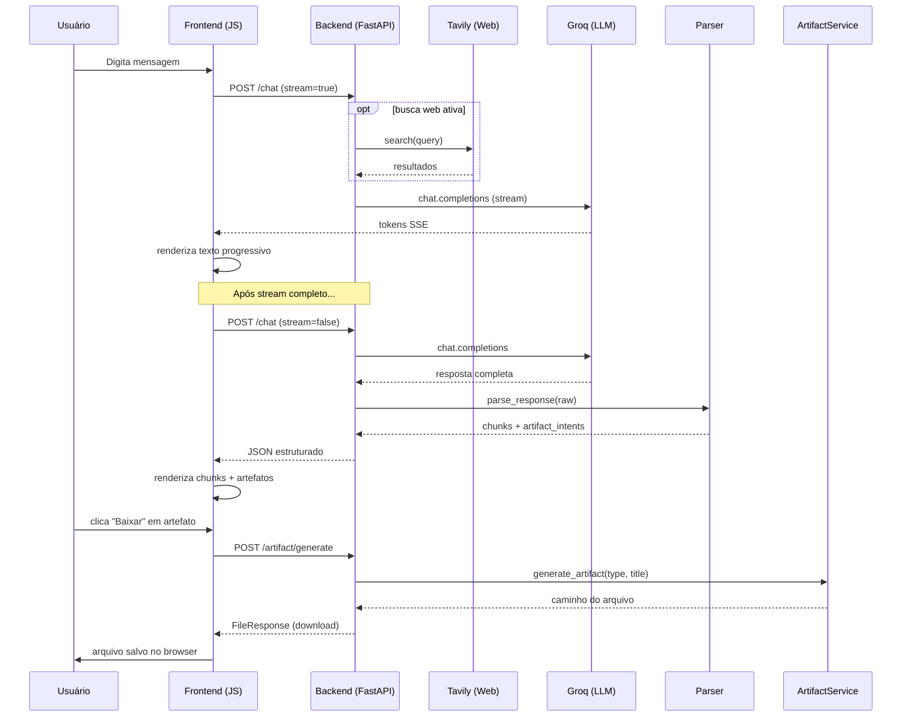

# AI Chat — FastAPI + Groq + Download de Artefatos

Chat de IA com streaming, renderização de código, busca web e geração/download real de arquivos (PDF, DOCX, XLSX, CSV, PNG, PPTX).

---

## Estrutura

```
ai-chat/
├── app.py                   # FastAPI — endpoints e servidor
├── requirements.txt
├── .env.example
├── services/
│   ├── groq_client.py       # Encapsula chamadas à Groq API
│   ├── response_parser.py   # Divide resposta em chunks (texto/código/artefatos)
│   ├── orchestrator.py      # Orquestra LLM + busca web + parsing
│   └── artifact_service.py  # Geração real de DOCX, PDF, XLSX, CSV, PNG, PPTX
└── static/
    ├── index.html
    ├── styles.css
    └── app.js
```

---

## Fluxo de dados



---

## Como rodar

### 1. Clone / copie os arquivos

```bash
cd ai-chat
```

### 2. Crie o ambiente virtual e instale dependências

```bash
python -m venv venv
source venv/bin/activate        # Windows: venv\Scripts\activate
pip install -r requirements.txt
```

### 3. Configure as chaves de API

```bash
cp .env.example .env
```

Edite `.env`:
```
GROQ_API_KEY=gsk_...      # https://console.groq.com
TAVILY_API_KEY=tvly-...   # https://app.tavily.com  (opcional, para busca web)
```

### 4. Rode o servidor

```bash
uvicorn app:app --reload
```

Acesse: **http://localhost:8000**

---

## Onde evoluir

| O que evoluir | Onde |
|---|---|
| Trocar o modelo LLM | `services/groq_client.py`: `GROQ_MODEL` |
| Mudar o prompt do sistema | `services/groq_client.py`: `SYSTEM_PROMPT` |
| Adicionar novo tipo de artefato | `services/artifact_service.py`: `GENERATORS` |
| Melhorar geração de PDF/DOCX | `services/artifact_service.py`: `generate_pdf()` / `generate_docx()` |
| Salvar histórico em banco | `services/orchestrator.py` + novo `db_service.py` |
| Migrar frontend para React | `static/app.js`: estrutura já separada por responsabilidade |
| Adicionar auth | `app.py`: middleware FastAPI + JWT |

---

## Endpoints

| Método | Rota | Descrição |
|---|---|---|
| `GET` | `/` | Página do chat |
| `GET` | `/health` | Status da API |
| `POST` | `/chat` | Chat (stream ou JSON) |
| `POST` | `/artifact/generate` | Gera e baixa artefato |
| `GET` | `/artifact/types` | Lista tipos suportados |

### Exemplo de body `/chat`
```json
{
  "messages": [{"role": "user", "content": "Crie um relatório PDF sobre vendas"}],
  "use_web": false,
  "stream": false
}
```

### Exemplo de body `/artifact/generate`
```json
{
  "type": "pdf",
  "title": "Relatório de Vendas Q1",
  "content": "Conteúdo opcional para incluir no arquivo"
}
```
