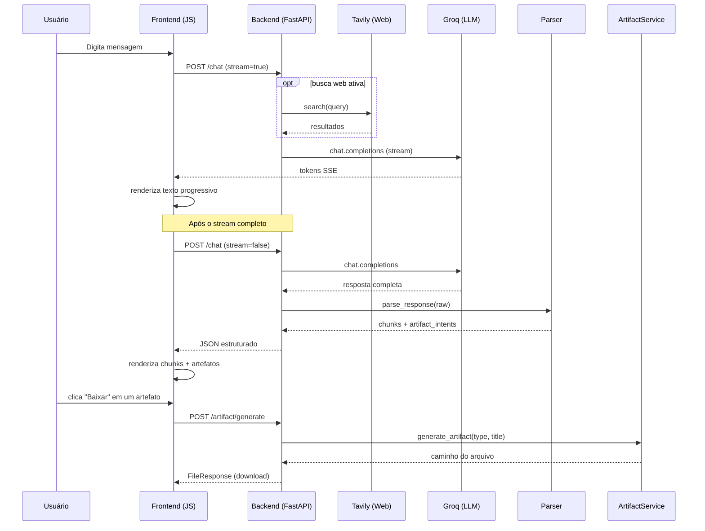

# ChatIA

Chat com IA em tempo real: respostas em streaming, busca na web, renderização de código e geração de arquivos reais (PDF, DOCX, XLSX, CSV, PNG, PPTX) a partir da conversa.

> **EN:** AI chat app built with FastAPI and Groq (Llama 3.3 70B). It streams answers token by token, optionally grounds them with web search (Tavily), detects code blocks as versioned artifacts and turns the conversation into downloadable files (PDF, DOCX, XLSX, CSV, PNG, PPTX).

## O que ele faz

- **Streaming de respostas** via SSE, com renderização progressiva de texto e blocos de código.
- **Busca web opcional** (Tavily): os resultados entram como contexto do prompt, com fontes.
- **Artefatos de arquivo**: o modelo só gera um arquivo quando o usuário pede explicitamente ("gere um PDF", "exporta para Excel"). Pesquisar ou resumir nunca dispara geração.
- **Artefatos de código**: blocos de código são detectados, classificados por linguagem, versionados e ficam prontos para download.
- **API documentada** pelo FastAPI em `/docs`.

## Stack

| Camada | Tecnologia |
|---|---|
| Backend | Python, FastAPI, Uvicorn |
| LLM | Groq API, modelo `llama-3.3-70b-versatile` |
| Busca web | Tavily |
| Geração de arquivos | python-docx, openpyxl, reportlab, python-pptx, matplotlib |
| Frontend | HTML, CSS e JavaScript puro (sem build) |

## Como funciona



### Decisões de projeto

- **Orquestração separada do cliente LLM.** `orchestrator.py` junta busca web, chamada ao modelo e parsing. `groq_client.py` só fala com a API, então trocar de provedor mexe em um arquivo.
- **O modelo sinaliza, o backend executa.** O prompt de sistema manda o LLM acrescentar uma linha `[ARTEFATO: tipo=pdf titulo="..."]` apenas quando há pedido explícito. O `response_parser.py` extrai essa intenção e o `artifact_service.py` gera o arquivo de verdade. Assim a resposta continua texto e o arquivo é criado por código determinístico.
- **Parser de blocos.** A resposta é dividida em chunks de texto e código, com detecção de linguagem por marcação do bloco e por heurística quando ela não é declarada.
- **Falhas de busca não derrubam o chat.** Erros do Tavily (chave inválida, limite de uso, consulta vazia) são tratados e a conversa segue sem contexto web.

## Estrutura

```
ChatIA/
├── app.py                        # FastAPI: endpoints e servidor
├── requirements.txt
├── env.example
├── services/
│   ├── groq_client.py            # chamadas à Groq e prompt de sistema
│   ├── orchestrator.py           # LLM + busca web + parsing
│   ├── response_parser.py        # divide a resposta em texto, código e intenções de artefato
│   ├── code_artifact_service.py  # detecção, versionamento e entrega de artefatos de código
│   └── artifact_service.py       # geração de DOCX, PDF, XLSX, CSV, PNG e PPTX
└── static/
    ├── index.html
    ├── styles.css
    └── app.js
```

## Como rodar

```bash
git clone https://github.com/igortavaresalves/ChatIA.git
cd ChatIA

python -m venv venv
source venv/bin/activate        # Windows: venv\Scripts\activate
pip install -r requirements.txt

cp env.example .env             # Windows: copy env.example .env
```

Preencha o `.env`:

```
GROQ_API_KEY=...      # https://console.groq.com
TAVILY_API_KEY=...    # https://app.tavily.com (opcional, habilita a busca web)
```

Suba o servidor:

```bash
uvicorn app:app --reload
```

Acesse http://localhost:8000.

## Endpoints

| Método | Rota | Descrição |
|---|---|---|
| `GET` | `/` | Página do chat |
| `GET` | `/health` | Status da API |
| `POST` | `/chat` | Chat (stream ou JSON) |
| `POST` | `/artifact/generate` | Gera e baixa um artefato |
| `GET` | `/artifact/types` | Lista os tipos suportados |

Exemplo de corpo do `/chat`:

```json
{
  "messages": [{"role": "user", "content": "Crie um relatório PDF sobre vendas"}],
  "use_web": false,
  "stream": false
}
```

Exemplo de corpo do `/artifact/generate`:

```json
{
  "type": "pdf",
  "title": "Relatório de Vendas Q1",
  "content": "Conteúdo opcional para incluir no arquivo"
}
```

## Próximos passos

- Persistir o histórico de conversas em banco de dados.
- Autenticação (middleware FastAPI com JWT).
- Testes automatizados para o parser de respostas e para os geradores de arquivo.
- Migrar o frontend para React e TypeScript.

## Autor

Igor Tavares, desenvolvedor backend e de soluções com IA, Recife (PE). [GitHub](https://github.com/igortavaresalves)
